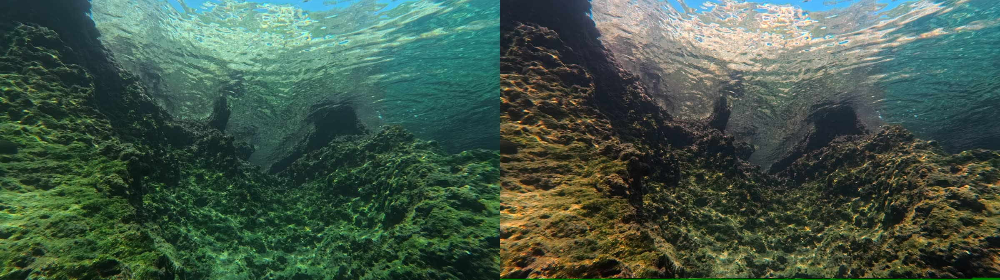
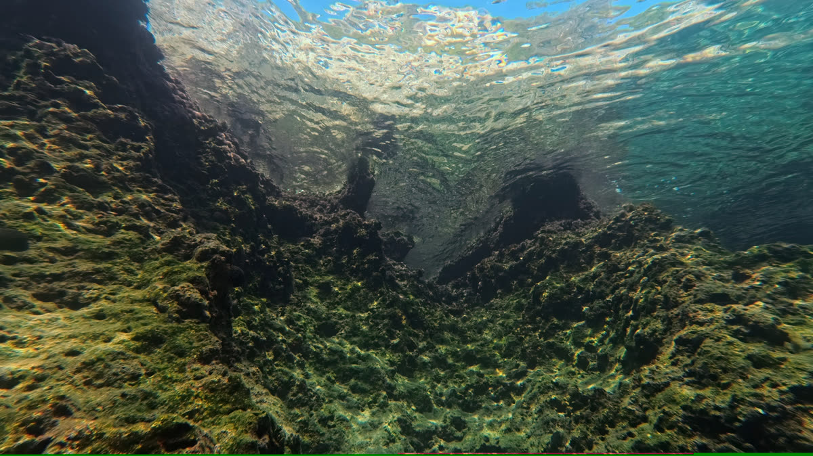
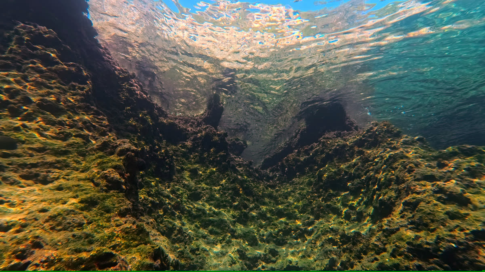
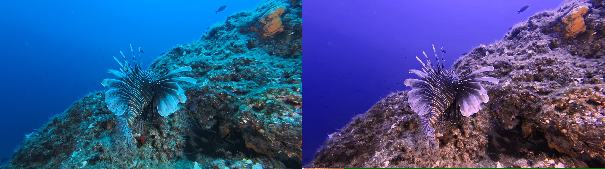
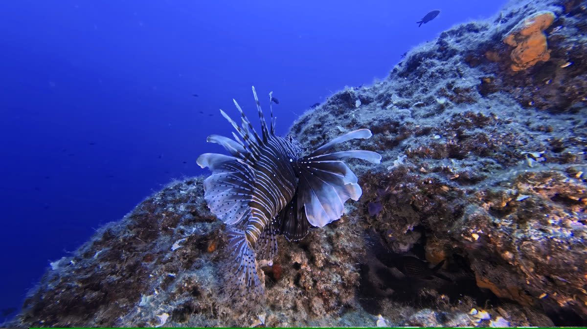

# divegrader Examples

This page shows practical recipes and before/after results using Insta360 Ace Pro footage.

---

## 1. Shallow green reef

**Goal**: turn the green reef brown while keeping the upper water blue.

**Command**:
```bash
divegrader shallow-green-reef.jpg \
  --profile reef \
  --white-balance off --dehaze 0.0 \
  -o reef-reef.jpg
```



**Try a softer blue-water look**:
```bash
divegrader shallow-green-reef.jpg \
  --profile deep-blue \
  -o reef-deep-blue.jpg
```



**Night profile** (for darker reef shots):
```bash
divegrader shallow-green-reef.jpg \
  --profile night --dehaze 0.3 \
  -o reef-night.jpg
```



---

## 2. Lionfish in blue water

**Goal**: restore natural reef colors without pushing the water magenta.

```bash
divegrader lion-fish-in-blue.jpg \
  --profile reef \
  -o lionfish-reef.jpg
```



**Use `deep-blue` if fully blue footage turns too red/magenta**:
```bash
divegrader lion-fish-in-blue.jpg \
  --profile deep-blue \
  -o lionfish-deep-blue.jpg
```



---

## 3. Video: NVIDIA GPU + stabilization

```bash
divegrader dive.mp4 \
  --hw nvenc --gpu --profile reef --stabilize \
  -o dive-stable-graded.mp4
```

What happens:
1. `Stabilizing` — vidstabdetect computes camera motion.
2. `Analyzing` — keyframes are decoded at 256×256 to compute grading matrices.
3. `Grading` — frames are color-corrected on the GPU and stabilized before NVENC encoding.
4. `Finishing` — audio/metadata are preserved.

---

## 4. Fast preview of a long video

A 5.5 GB / 6-minute clip does not need a full render to check color:

```bash
# first 10 seconds
divegrader dive.mp4 --preview 10 --hw nvenc --gpu

# last 8 seconds of a 60-second clip
divegrader dive.mp4 --preview 8 --seek 52 --hw nvenc --gpu
```

Preview mode drops audio for speed.

---

## 5. Batch processing (keep folder structure)

```bash
divegrader -r ./dives -o ./graded \
  --hw nvenc --gpu --jobs 8 --profile reef
```

Input:
```text
dives/boat/reef.mp4
dives/boat/wreck.mp4
dives/cave/night.mp4
```

Output:
```text
graded/dives/boat/reef_graded.mp4
graded/dives/boat/wreck_graded.mp4
graded/dives/cave/night_graded.mp4
```

---

## 6. Profile override

Profiles are starting points; explicit flags win:

```bash
# reef profile, but add more red
divegrader photo.jpg --profile reef --min-avg-red 100

# fully blue scene, keep reds restrained
divegrader video.mp4 --profile deep-blue --strength 0.7

# green water
divegrader wreck.mp4 --profile green-water --dehaze 0.4
```

---

## 7. Save and reuse a look

```bash
# save the resolved settings
divegrader photo.jpg --profile reef --dehaze 0.2 --save-config reef.toml

# reuse on another dive
divegrader ./dives -r --config reef.toml --hw nvenc
```

Example `reef.toml`:
```toml
profile = "reef"
min_avg_red = 60.0
blue_magic = 1.2
strength = 1.0
water = "blue"
depth = "auto"
green_gain_cap = 1.0
white_balance = "off"
dehaze = 0.2
black_point = "auto"
exposure = "auto"
blue_hue = "auto"
```

---

## 8. Scripts / CI (no TUI)

```bash
divegrader -r ./in -o ./out --silent --hw nvenc --gpu
```

If any file fails, the process prints `Finished with N errors` and writes `divegrader-errors.log` in the output directory (or current directory).

---

## More information

- [Full option reference](DOCS.md)
- [README](README.md)
- [Changelog](CHANGELOG.md)
