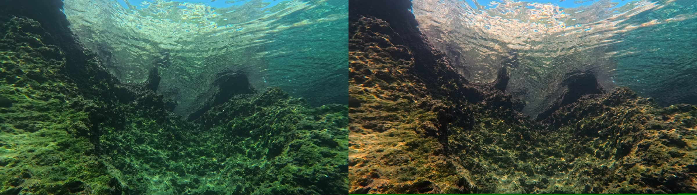
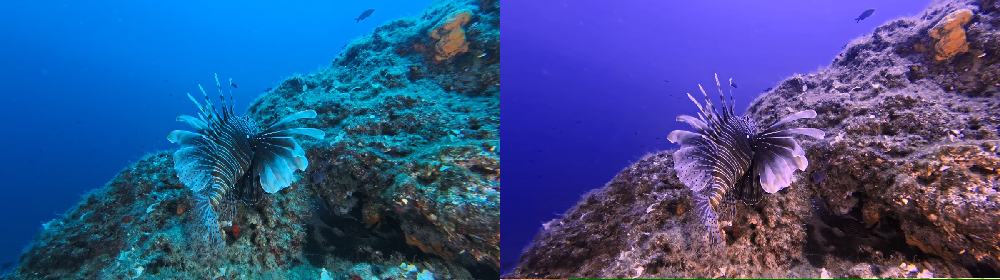

# 🤿 divegrader

**divegrader** is a fast, open-source (AGPL-3.0) command-line tool written in Rust for automatic underwater photo and video color correction.

Water absorbs red light quickly at depth, leaving scuba, freediving, and snorkeling footage heavily tinted blue or green. `divegrader` restores natural colors with smart water/depth detection, green-channel protection, dynamic video grading, and optional stabilization — without stripping audio or metadata.





## ✨ Features

- **Smart scuba grading**: blue/green water detection from the water column, depth-aware red restoration, green gain capped at 1.0.
- **Scene profiles**: `reef`, `deep-blue`, `wreck`, `cave`, `night`, `shallow`, `deep`, `green-water`, `red-boost`.
- **Fine-grained controls**: explicit CLI flags always override profiles (`--profile reef --min-avg-red 100`).
- **Photo and video**: JPEG/PNG/TIFF and MP4/MKV/MOV/AVI/WebM.
- **Dynamic video grading**: keyframe sampling, scene-change detection, temporal smoothing, median keyframe mode.
- **Extra grading**: dehaze, black point, auto exposure, blue-hue correction, grey-world white balance (opt-in).
- **GPU color processing**: wgpu (Vulkan/Metal/DX12) with automatic CPU fallback (`--gpu`).
- **NVIDIA**: CUDA decode + NVENC H.264/H.265 encoding (`--hw nvenc`).
- **Video stabilization**: FFmpeg vidstab (`--stabilize`) with progress.
- **Fast previews**: `--preview 10 --seek 52` to grade any short window of a long clip.
- **Batch processing**: files, globs, or recursive directories; parallel jobs; output structure preserved.
- **Nice TUI**: live CPU/RAM/GPU stats, vertical load bars, action progress, settings panel, and log.
- **Audio & metadata safe**: audio copied 1:1, EXIF preserved on JPEG, video metadata retained.
- **Reliable**: `q` aborts and kills FFmpeg; errors write `divegrader-errors.log`.
- **Cross-platform**: Windows, macOS, Linux release binaries built by GitHub Actions.

## 🖥️ TUI preview

```text
┌──────────────────────────────────────────────┬──────────────────────────────┐
│ ⠹ divegrader  0.4 / 3 files  01:23             │ CPU / Memory     CPU load    │
│ ┌ Overall  0.4 / 3 ──────────────────────────┐│ CPU 42%  RAM 18/32GB   ░░░    │
│ │████████████████░░░░░░░░░░░░░░░░  14%        ││ Graphics       GPU load     │
│ └────────────────────────────────────────────┘│ RTX 5070  14%      ░░░      │
│ ┌ Current: dive.mp4 [Grading] ──────────────┐│ Software                     │
│ │███████████████████░░░░░░░░░░░░  52%        ││ ffmpeg 8.1  divegrader 0.6.0 │
│ └────────────────────────────────────────────┘│ Grading                     │
│ ┌ Log ──────────────────────────────────────┐│ profile: reef                │
│ │→ dive.mp4 Stabilizing                     ││ min_avg_red: 60              │
│ │→ dive.mp4 Analyzing                       ││ water: blue   depth: auto    │
│ │→ dive.mp4 Grading                         ││                             │
│ └────────────────────────────────────────────┘┴──────────────────────────────┘
```

TUI starts automatically on a real terminal. Use `--silent` for scripts and CI.

## 🚀 Quick start

```bash
# Grade a photo (writes photo_graded.jpg next to input)
divegrader photo.jpg

# Grade a video, keep audio and metadata
divegrader dive_video.mp4 -o graded_video.mp4

# NVIDIA GPU decode + color processing + NVENC H.265
divegrader dive_video.mp4 --hw nvenc --gpu --profile reef

# Stabilize + grade
divegrader dive_video.mp4 --hw nvenc --stabilize

# Preview only 8 seconds near the end of a long video (no audio)
divegrader dive_video.mp4 --preview 8 --seek 52

# Recursive batch, preserve folder structure, 8 parallel files
divegrader -r ./dives -o ./graded --jobs 8 --codec x265 --crf 18
```

## 🎨 Profiles

| Profile | Best for |
| --- | --- |
| `reef` | Blue-water reef dives |
| `deep-blue` | Very blue/deep footage prone to magenta overshoot |
| `wreck` | Green-water wrecks |
| `cave` | Dark/blue cave dives |
| `night` | Low-light/night dives |
| `green-water` | Heavy green water |
| `red-boost` | Strong red restoration |
| `shallow` / `deep` | Simple red-restoration strength presets |

See [EXAMPLES.md](EXAMPLES.md) for before/after images and copy-paste recipes.

## 📚 Documentation

- **[Full option reference — DOCS.md](DOCS.md)**
- **[Examples — EXAMPLES.md](EXAMPLES.md)**
- **[Changelog — CHANGELOG.md](CHANGELOG.md)**
- **[Releases](https://github.com/quenode/divegrader/releases)**

## 🛠️ Requirements

- Rust 1.85+ to build from source.
- FFmpeg 8.x recommended for CUDA decode + NVENC on modern NVIDIA GPUs.
- Optional GPU for `--gpu` (Vulkan/Metal/DX12).

## 🗺️ Roadmap

- [x] Photo and video color correction
- [x] GPU processing + NVENC/CUDA acceleration
- [x] Stabilization
- [x] TUI with system stats
- [x] Fast preview mode
- [ ] GyroFlow metadata-based stabilization
- [ ] Immich companion service (automatic grading of tagged albums and stacking with originals)

## 📄 License

AGPL-3.0. See [LICENSE](LICENSE). The original color-correction algorithm is adapted from
[dive-color-corrector](https://github.com/bornfree/dive-color-corrector) (MIT).
